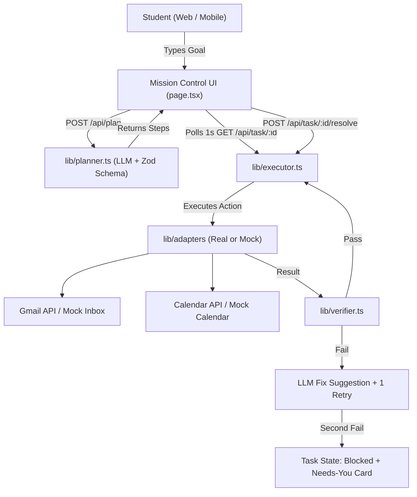

# Architecture Research

**Domain:** Autonomous Productivity & Mission Control (Email & Calendar Agent)
**Researched:** 2026-10-15
**Confidence:** HIGH

## System Architecture

## Component Boundaries

1. **Mission Control UI (`app/page.tsx`)**:
   - Polling engine (1s interval) fetching active task state.
   - Live visual timeline with clear icons and status tags (`pending`, `running`, `done`, `failed`, `blocked`).
   - "Needs you" resolution card displaying error details, parameter diffs, and action buttons (`Retry`, `Edit`, `Skip`).
   - Demo drawer with `DEMO_MODE` toggle and `FAIL_NEXT` simulation switch.

2. **Planner (`lib/planner.ts`)**:
   - Takes natural language goal and outputs rigid JSON matching the Zod action schema.
   - Only permitted to emit actions from the constrained enum:
     - `gmail.search`: `{ query: string }`
     - `gmail.send`: `{ to: string, subject: string, body: string }`
     - `calendar.create`: `{ title: string, time: string, durationMinutes?: number }`
     - `calendar.check`: `{ timeRangeStart: string, timeRangeEnd: string }`

3. **Executor (`lib/executor.ts`)**:
   - In-memory task state store (`tasks: Map<string, TaskState>`).
   - Executes steps sequentially.
   - Hands each step's output to `lib/verifier.ts`.
   - Manages retry counters and handles human resolution triggers (`POST /api/task/:id/resolve`).

4. **Verifier (`lib/verifier.ts`)**:
   - Independent verification check per action:
     - `gmail.search`: $\ge 1$ search match found AND a valid date/time was extracted.
     - `gmail.send`: Message ID exists in the user's `SENT` box.
     - `calendar.create`: `events.get(id)` returns valid event AND no overlapping conflict.
     - `calendar.check`: Free/busy result successfully returned.

5. **Adapters (`lib/adapters/`)**:
   - Common interface `AgentAdapter` implemented by:
     - `real`: `gmail.ts` and `gcal.ts` using `googleapis` with OAuth 2.0.
     - `mock`: `mock.ts` holding 10 seeded recruiter emails, fake event store, and `FAIL_NEXT` flag.
